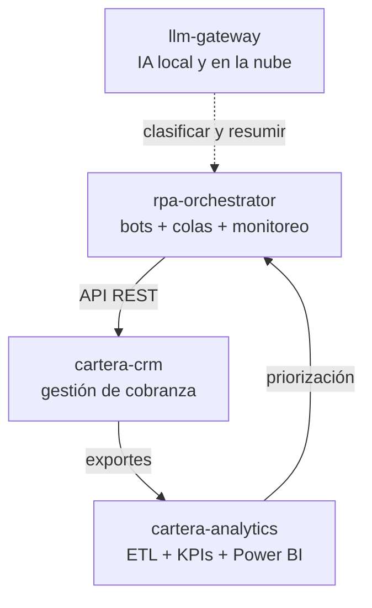

# Hola, soy Darwin Montiel Mora 👋

### Desarrollador RPA & Backend · Ingeniero de Sistemas · Bogotá, Colombia

Construyo **bots que automatizan procesos sobre aplicativos web** y los sistemas que los hacen
confiables en producción: colas de mensajes, trazabilidad, monitoreo, despliegues y datos.

---

## Sobre mí

- 🤖 **3 años** en desarrollo de software, **automatización robótica de procesos (RPA)** y análisis de datos.
- 🏦 En una **fintech multinacional de gestión de cartera** (Colombia, Chile y Perú) desarrollé bots en
  Python que operan aplicativos web, integrados con **RabbitMQ** y **PostgreSQL**, y el proyecto de
  **monitoreo de bots**; además gestioné servidores **Windows y Linux** y los **despliegues a producción**.
- 🧩 Experiencia en **Ruby on Rails** (Turbo/Stimulus), **Robocorp** y **Blue Prism** (Control Room),
  y en **BI**: Power BI, DAX, Pandas y Excel avanzado.
- 🎯 Me interesa la **hiperautomatización**, las **arquitecturas orientadas a mensajes** y la
  **eficiencia operativa** en cobranza y gestión de cartera.

## Proyectos destacados

| Proyecto | Qué demuestra | Stack |
|---|---|---|
| [**rpa-orchestrator**](https://github.com/DarwinMontiel/rpa-orchestrator) · [demo](https://darwinmontiel.github.io/rpa-orchestrator/) | Plataforma de bots RPA a escala: tareas por colas RabbitMQ con reintentos TTL y DLQ, idempotencia, trazabilidad en PostgreSQL, monitoreo de bots y despliegue en Linux y Windows Server | Python · RabbitMQ · PostgreSQL · Playwright · FastAPI · Docker |
| [**cartera-analytics**](https://github.com/DarwinMontiel/cartera-analytics) · [tablero](https://darwinmontiel.github.io/cartera-analytics/) | ETL de cartera y cobranza: 29 reglas de calidad de datos, modelo estrella, KPIs (PAR30, roll rates, recaudo), Power BI/DAX y reporte Excel; pandas y SQL verificados entre sí | Python · pandas · PostgreSQL · SQL · Power BI · Excel |
| [**cartera-crm**](https://github.com/DarwinMontiel/cartera-crm) | CRM de cobranza: bandeja de cobro, gestiones y promesas, acuerdos de pago en días hábiles, API REST para bots e integridad garantizada por la base de datos | Ruby on Rails 8 · Hotwire · PostgreSQL · Kamal |
| [**llm-gateway**](https://github.com/DarwinMontiel/llm-gateway) | Cliente unificado para LLM locales y en la nube con streaming, reintentos y *fallback* | Python · httpx · Ollama · Groq |
| [**robocorp-order-robot**](https://github.com/DarwinMontiel/robocorp-order-robot) | Bot de la certificación Robocorp: Page Object, reintentos, recibos PDF y resiliencia por pedido | Python · Robocorp · RPA Framework |

### Cómo se conectan

Los tres primeros modelan una operación de cobranza completa: los bots ejecutan el trabajo
repetitivo, el CRM es la herramienta de los gestores y la analítica mide los resultados.

## Tecnologías

**Lenguajes:**    

**RPA y automatización:**   

**Backend y mensajería:**     

**Bases de datos:**   

**Infraestructura y DevOps:**     

**Datos y BI:**   

## Experiencia

| Período | Rol | Empresa |
|---|---|---|
| 2026 | Desarrollador RPA | **Liquitty** · fintech de gestión de cartera (Colombia, Chile y Perú) |
| 2025 – 2026 | Desarrollador de Software | **Narnaja Business Intelligence** · RPA e IA, dashboards de BI y plataformas web |
| 2023 – 2024 | Desarrollador de Software | **PulpiFrut** · scripts de datos con pandas, frontend y dashboards de Power BI |
| 2022 – 2023 | Analista BI Junior (prácticas) | **Emtelco** · línea de cobranzas |

## Certificaciones

- **Blue Prism Developer Certification** — SS&C Blue Prism
- **Automation Developer – Python** — Robocorp
- **PCAP – Programming Essentials in Python** — Cisco
- **DevOps** — Cisco

## Formación

**Ingeniería de Sistemas** — Universidad ECCI (2020 – 2025, pensum académico finalizado)

---

¿Hablamos de automatización, backend o datos? Escríbeme por <a href="https://www.linkedin.com/in/darwin-montiel-mora-925216206">LinkedIn</a>.

