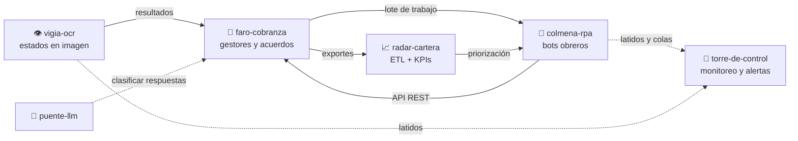

# Hola, soy Darwin Montiel Mora 👋

### Desarrollador RPA & Backend · Bogotá, Colombia

**Python · Playwright · Selenium · RabbitMQ · SQL Server · PostgreSQL · Docker**

Construyo **bots que automatizan procesos sobre aplicativos web** y los sistemas que los hacen
confiables en producción: colas con reintentos y DLQ, idempotencia, OCR, monitoreo en tiempo real
y despliegues automáticos.

---

## En pocas cifras

| | |
|---|---|
| 🤖 **+12.000** | expedientes jurídicos en alcance de 3 bots RPA que sincronizan con 3 bancos (el primero en producción en 5 semanas) |
| 👁️ **≈65 % → ≈99 %** | de acierto al leer imágenes con OCR (ddddocr, EasyOCR, Tesseract) en un portal público |
| 🧪 **+400** | pruebas automatizadas con pytest; idempotencia, verificación tras guardar y *circuit breaker* |
| 📡 **56 colas · 37 servidores · 26 bots** | vigilados por una plataforma de monitoreo en tiempo real (TypeScript, PostgreSQL) |
| ⚡ **2 días** | para llevar un bot de pagarés desmaterializados a otra cartera y a producción: 981 pagarés |

Tres años en desarrollo de software, RPA y datos; los últimos en una **fintech multinacional de gestión
de cartera** (Colombia, Chile y Perú). Certificado en **Blue Prism** y **Robocorp**.

## Cómo trabajo

- **Fiabilidad por diseño.** Idempotencia, verificación tras guardar, reintentos con espera y colas de
  mensajes muertos. Si un bot no está seguro de un dato, lo dice en vez de inventarlo.
- **Observabilidad desde el inicio.** Latidos, colas y alertas con escalamiento: un bot caído se nota
  en minutos, no al otro día.
- **Calidad automatizada.** Pruebas, tipos estrictos, lint e integración continua en cada repositorio,
  con Dependabot y detección de secretos.
- **Decisiones a la vista.** Cada proyecto documenta su arquitectura y sus decisiones (ADR), cómo
  ejecutarlo, probarlo y desplegarlo.

## Proyectos

Juntos modelan una operación de cobranza ficticia: las obreras trabajan, la torre las vigila, el vigía
lee lo que los demás no pueden, el faro guía a los gestores y el radar mide los resultados.

| Proyecto | Qué demuestra | Stack |
|---|---|---|
| 🐝 [**colmena-rpa**](https://github.com/DarwinMontiel/colmena-rpa) · [demo](https://darwinmontiel.github.io/colmena-rpa/) | Bots obreros por colas RabbitMQ con reintentos escalonados y DLQ, idempotencia, trazabilidad en PostgreSQL y despliegue como servicio en Linux y Windows Server | Python · RabbitMQ · PostgreSQL · Playwright · FastAPI |
| 🗼 [**torre-de-control**](https://github.com/DarwinMontiel/torre-de-control) · [demo](https://darwinmontiel.github.io/torre-de-control/) | Monitoreo en tiempo real de bots: colas, latidos, servidores y alertas; API documentada, eventos por WebSocket y SDK en Python | TypeScript · Fastify · Redis · PostgreSQL · WebSocket · Vitest |
| 👁️ [**vigia-ocr**](https://github.com/DarwinMontiel/vigia-ocr) · [demo](https://darwinmontiel.github.io/vigia-ocr/) | Bot Selenium que lee estados en imagen con varios motores OCR y votación, guarda en SQL Server y mide su propio acierto; arquitectura hexagonal | Python · Selenium · OCR · SQL Server · pytest |
| 📈 [**radar-cartera**](https://github.com/DarwinMontiel/radar-cartera) · [tablero](https://darwinmontiel.github.io/radar-cartera/) | ETL con 29 reglas de calidad de datos, modelo estrella y KPIs (PAR30, roll rates, promesas) en Power BI/DAX y Excel; pandas y SQL verificados entre sí | Python · pandas · PostgreSQL · Power BI |
| 🏮 [**faro-cobranza**](https://github.com/DarwinMontiel/faro-cobranza) | CRM de cobranza: bandeja por mora, promesas, acuerdos con cuotas en días hábiles (festivos de Colombia) y API REST idempotente para bots | Ruby on Rails 8 · Hotwire · PostgreSQL |
| 🌉 [**puente-llm**](https://github.com/DarwinMontiel/puente-llm) | Una interfaz para un LLM local y uno en la nube, con streaming, reintentos y respaldo automático | Python · httpx · Ollama · Groq |
| 📊 [**control-valor-ganado**](https://github.com/DarwinMontiel/control-valor-ganado) | Control de proyectos con Valor Ganado (EVM): CPI, SPI, EAC y alertas con semáforo; los casos borde devuelven `null` explicado, nunca un 0 inventado; Swagger y Docker Compose | Python · FastAPI · PostgreSQL · React · TypeScript |
| 🤖 [**robot-pedidos-robocorp**](https://github.com/DarwinMontiel/robot-pedidos-robocorp) | Bot de la certificación Robocorp: Page Object, reintentos, recibos PDF y reporte de turno | Python · Robocorp |
| ✈️ [**tu-amigo-viajero**](https://github.com/DarwinMontiel/tu-amigo-viajero) · [sitio](https://darwinmontiel.github.io/tu-amigo-viajero/) | Agencia de viajes (proyecto académico en equipo, 2022, revisado en 2026): buscador que compara vuelos y hoteles reales en seis páginas con clima y tasa de cambio en vivo, simulador de pago a cuotas, contraste AA y pruebas en CI | HTML · Sass · JavaScript · APIs REST |

### Cómo se conectan

## Tecnologías

| Área | Herramientas |
|---|---|
| Lenguajes | Python · TypeScript · SQL · JavaScript · Ruby |
| RPA y automatización | Playwright · Selenium · OCR (ddddocr, EasyOCR, Tesseract) · Blue Prism · Robocorp · Control Room |
| Backend y mensajería | RabbitMQ · APIs REST · Node.js · Fastify · Redis · WebSocket · FastAPI · Ruby on Rails |
| Bases de datos | SQL Server · PostgreSQL · MySQL |
| DevOps e infraestructura | Docker · nginx · Linux · Windows Server · Git · GitLab · GitHub Actions |
| Calidad y pruebas | pytest · Vitest · mypy · Ruff |
| Datos y BI | pandas · Power BI · DAX · Power Query · Excel avanzado |

## Experiencia

| Período | Rol | Empresa |
|---|---|---|
| May 2026 – Nov 2026 | Desarrollador RPA | **Liquitty** · fintech multinacional de gestión de cartera (Colombia, Chile y Perú) |
| Sep 2025 – Ene 2026 | Desarrollador de Software | **Narnaja Business Intelligence** · RPA e IA, dashboards de BI y plataformas web |
| Jun 2023 – Dic 2024 | Desarrollador de Software | **PulpiFrut** · datos con pandas, frontend, Excel y Power BI |
| Sep 2022 – Feb 2023 | Analista BI (prácticas) | **Emtelco** · línea de cobranzas |

## Certificaciones y formación

- **Blue Prism Developer Certification** — SS&C Blue Prism
- **Automation Developer – Python (niveles I a III)** — Robocorp, 2025
- **PCAP: Programming Essentials in Python** — Cisco Networking Academy, 2024
- **CyberOps Associate** — Cisco, 2025
- **Ingeniería de Sistemas** — Universidad ECCI (2020 – 2025) · plan de estudios terminado, pendiente de grado

**Idiomas:** español nativo · inglés pre-intermedio (A2)

---

¿Hablamos de automatización, backend o datos? · <a href="mailto:darwinmontielm@gmail.com">darwinmontielm@gmail.com</a> · <a href="https://www.linkedin.com/in/darwin-montiel-mora-925216206">LinkedIn</a> · <a href="https://darwinmontiel.github.io">darwinmontiel.github.io</a>

